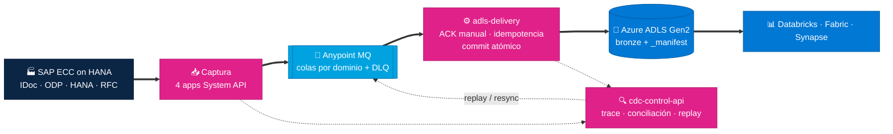
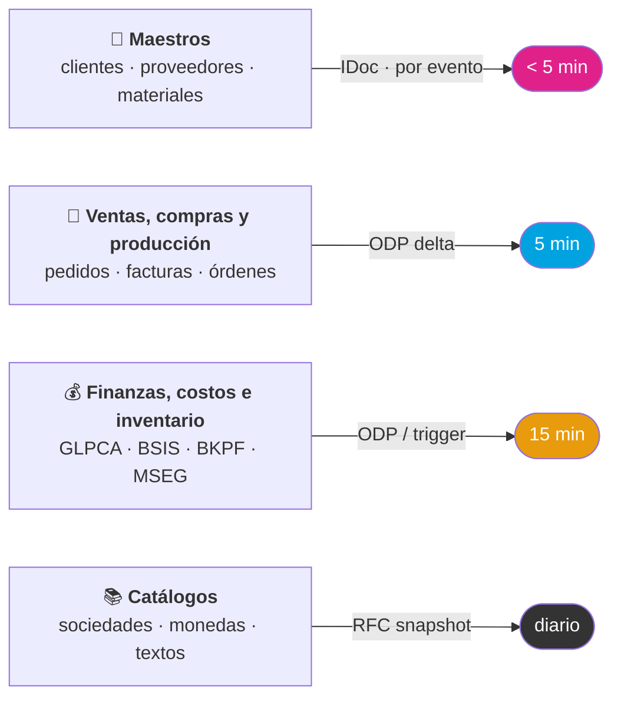
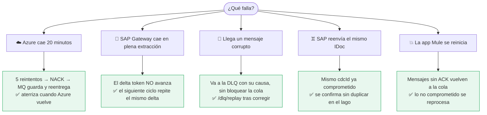
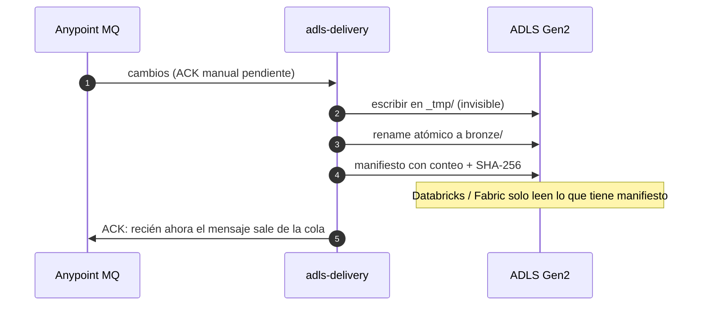
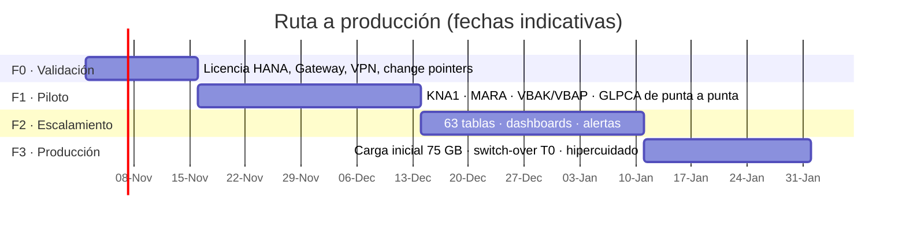

<div align="center">

# Artes Gráficas · CDC de SAP a Azure Data Lake

### Cada cambio en SAP, en el Data Lake. Sin perder uno solo.

**Change Data Capture con MuleSoft Anypoint Platform:** entrega garantizada, reintentos inteligentes,
transaccionalidad y trazabilidad de punta a punta.


[**📐 Arquitectura detallada**](docs/ARQUITECTURA.md) · [**🖥️ Presentación interactiva**](html/ArtesGraficas_CDC_MuleSoft.html) · [**📄 Planteamiento**](Planteamiento_CDC_SAP_Azure_MuleSoft.md) · [**💻 Código**](mule/)

</div>

---

## En 30 segundos

| | |
|---|---|
| **El reto** | Llevar de forma continua los cambios de **SAP ECC on HANA** (63 tablas, ~75 GB) a **Azure Data Lake**, capturando altas, cambios **y borrados**, sin perder ni duplicar un registro. |
| **La solución** | Una arquitectura **API-led y orientada a eventos** sobre MuleSoft. Conectores de captura intercambiables (IDoc, ODP, triggers HANA, RFC) publican un **contrato CDC único** en Anypoint MQ, y una app de entrega lo escribe en el lago con **commit atómico**. |
| **La prueba** | 6 aplicaciones Mule **compiladas y con 17 pruebas automatizadas en verde**. Cada garantía (reintentos, DLQ, idempotencia, delta token) está demostrada con una prueba. |
| **El costo** | **~1.1 vCores** permanentes para ~15,000 cambios por día hábil. |

<table>
<tr>
<td align="center"><h2>63</h2>tablas SAP</td>
<td align="center"><h2>~15K</h2>cambios / día hábil</td>
<td align="center"><h2>4</h2>niveles de reintento</td>
<td align="center"><h2>&lt; 5 min</h2>latencia en maestros</td>
<td align="center"><h2>0</h2>cambios perdidos</td>
</tr>
</table>

---

## La arquitectura en una imagen



> **Principio rector:** *nada se confirma antes de que el siguiente paso lo haya persistido.*
> El IDoc no se libera, el delta token no avanza y el mensaje no sale de la cola hasta que el dato está seguro en el lago.

👉 Ver los 11 diagramas (capas, contrato, secuencias, estados, despliegue) en **[docs/ARQUITECTURA.md](docs/ARQUITECTURA.md)**.

---

## Latencia a la medida de cada dominio



---

## Las 5 garantías y dónde viven en el código

| Garantía | Cómo se cumple | Código |
|---|---|---|
| 🔒 **Entrega garantizada** | ACK **manual** de Anypoint MQ solo después del commit en ADLS; IDoc con tRFC; delta token y marca `PROCESSED` solo al final | [`adls-delivery.xml`](mule/adls-delivery/src/main/mule/adls-delivery.xml) |
| ♻️ **Reintentos** | 4 niveles: reconexión → `until-successful` **selectivo** (solo 429/503/timeout) → reentrega de MQ → `/dlq/replay` | [`adls-selective-retry-handler`](mule/adls-delivery/src/main/mule/adls-delivery.xml) |
| 🧮 **Transaccionalidad** | Commit atómico `_tmp → rename → _manifest` por tabla; transacción local por fila en HANA; tRFC en IDoc | [`hana-trigger-cdc.xml`](mule/hana-trigger-cdc/src/main/mule/hana-trigger-cdc.xml) |
| 🪪 **Idempotencia** | `cdcId` **determinista** (hash de la posición en SAP), registrado solo **después** del commit | [`Envelope.dwl`](mule/cdc-common/dw/cdc/Envelope.dwl) |
| 🔍 **Trazabilidad** | `correlationId` de punta a punta, logs JSON por etapa, auditoría en Azure SQL y conciliación diaria automática | [`cdc-control-api.xml`](mule/cdc-control-api/src/main/mule/cdc-control-api.xml) |

---

## ¿Qué pasa si…?



Cada uno de estos escenarios está **cubierto por una prueba MUnit** y se puede **ver en vivo** en el simulador de la [presentación interactiva](html/ArtesGraficas_CDC_MuleSoft.html).

---

## Commit atómico: el lago nunca ve un archivo a medias



---

## Presentación interactiva

[`html/ArtesGraficas_CDC_MuleSoft.html`](html/ArtesGraficas_CDC_MuleSoft.html) es un solo archivo HTML, sin dependencias, con:

- 🎞️ Arquitectura animada
- 🧪 **Simulador de fallas:** caída de Azure, throttling, mensaje corrupto, duplicado, SAP Gateway caído
- 🧱 Commit atómico paso a paso
- 🧭 Trazabilidad y conciliación
- 🗂️ Carga inicial reanudable

> **Cómo verla:** descarga el archivo y ábrelo en el navegador, o habilita **GitHub Pages** (*Settings → Pages → Branch `main` / root*) y abre
> `https://<usuario>.github.io/<repo>/html/ArtesGraficas_CDC_MuleSoft.html`.

---

## Estructura del repositorio

```text
.
├── README.md                              ← estás aquí
├── Planteamiento_CDC_SAP_Azure_MuleSoft.md ← planteamiento completo de la solución
├── docs/
│   ├── ARQUITECTURA.md                    ← 11 diagramas Mermaid
│   └── superpowers/                       ← especificación y plan de implementación
├── html/
│   └── ArtesGraficas_CDC_MuleSoft.html    ← presentación interactiva
└── mule/
    ├── cdc-common/        contrato: JSON Schema + módulo DataWeave del sobre CDC
    ├── sap-idoc-cdc/      maestros por IDoc (tRFC)
    ├── sap-odp-cdc/       deltas ODP vía OData
    ├── hana-trigger-cdc/  triggers HANA → ZCDC_LOG (licencia enterprise)
    ├── sap-initial-load/  carga histórica con Batch Job + /resync
    ├── adls-delivery/     entrega garantizada y commit atómico
    └── cdc-control-api/   trazabilidad, conciliación, replay (RAML + APIkit)
```

---

## Calidad verificada

| Proyecto | Pruebas | Qué demuestra |
|---|---|---|
| `adls-delivery` | 7 ✔ · cobertura 94 % | ACK solo tras commit · 503 → 6 intentos + NACK · 400 → DLQ sin reintento · duplicado comprometido → ACK · reentrega no comprometida → se reprocesa |
| `sap-odp-cdc` | 4 ✔ · cobertura 95 % | El delta token avanza solo si se publicó todo; con 4xx o 503 **no** avanza |
| `sap-idoc-cdc` | 1 ✔ | IDoc DEBMAS07 real → sobres KNA1 / KNVV con DOCNUM como correlationId |
| `sap-initial-load` | 2 ✔ | Plan de 68 particiones · página RFC → registros `op = R` |
| `hana-trigger-cdc` · `cdc-control-api` | 1 ✔ · 2 ✔ | Todos los flujos inicializan y su DataWeave compila |

Además, una **revisión independiente** del código encontró 10 hallazgos, y se corrigieron los 9 que eran de código. El más importante es que hoy un cambio solo se marca como entregado después de quedar en el lago. El décimo pedía ajustar textos del HTML, que ya se actualizaron. Detalle en [`mule/README.md`](mule/README.md).

### Construir y probar

```bash
export JAVA_HOME=<JDK 17>
cd mule/adls-delivery
mvn clean package        # compila + ejecuta MUnit
```

> En Windows, MUnit requiere una ruta sin acentos: copia el proyecto a, por ejemplo, `C:\work\cdc\` o ejecútalo en CI.

---

## Plan de implementación



### Validaciones con Artes Gráficas

| # | Tema | Por qué importa |
|---|---|---|
| V1 | Licencia HANA *enterprise* o *runtime* | Con *runtime* no se permite SQL directo: se descartan los triggers y se usan ODP, IDoc y RFC |
| V2 | SAP Gateway / extractores ODP | Canal OData para los deltas (SAP Note 3255746) |
| V3 | VPN SAP ↔ CloudHub 2.0 Private Space | Conectividad privada |
| V4 | Change pointers DEBMAS / CREMAS / MATMAS | Captura por evento de los maestros |
| V5 | ADLS Gen2 con namespace jerárquico | Garantiza el rename atómico |
| V6 | SAP JCo (`sapjco3`) | Librería requerida en runtime por el SAP Connector |

---

## ¿Por qué MuleSoft?

- **Un solo runtime** para IDoc, RFC, OData, SQL, colas y REST de Azure, en lugar de varias herramientas separadas.
- **Las garantías son configuración, no código a la medida:** ACK manual, DLQ, reconexión, `until-successful` y Object Store.
- **API-led reutilizable:** el mismo contrato CDC y la misma API de control sirven mañana para Salesforce, WMS o MES.
- **Operación visible:** Anypoint Monitoring, API Manager y Runtime Manager en una sola consola.
- **Preparado para S/4HANA:** una migración futura solo cambia los conectores de captura; la entrega, el lago y la operación no cambian.

---

<div align="center">

**Propuesta elaborada por [SP Solutions](https://www.spsolutions.com.mx) para Artes Gráficas** · 2026 · Confidencial

</div>
