# Arquitectura: CDC de SAP a Azure Data Lake con MuleSoft

> Documento técnico de referencia para **Artes Gráficas**. Para la visión ejecutiva, ver el [README](../README.md).
> Para la presentación interactiva, ver [`html/ArtesGraficas_CDC_MuleSoft.html`](../html/ArtesGraficas_CDC_MuleSoft.html).

**Contenido**

1. [Vista general](#1-vista-general)
2. [Capas API-led](#2-capas-api-led)
3. [El sobre CDC: un solo contrato](#3-el-sobre-cdc-un-solo-contrato)
4. [Captura por dominio](#4-captura-por-dominio)
5. [Entrega garantizada de punta a punta](#5-entrega-garantizada-de-punta-a-punta)
6. [Reintentos en 4 niveles](#6-reintentos-en-4-niveles)
7. [Commit atómico en ADLS Gen2](#7-commit-atómico-en-adls-gen2)
8. [Ciclo de vida de un cambio](#8-ciclo-de-vida-de-un-cambio)
9. [Trazabilidad y conciliación](#9-trazabilidad-y-conciliación)
10. [Carga inicial y paso a delta](#10-carga-inicial-y-paso-a-delta)
11. [Despliegue en CloudHub 2.0](#11-despliegue-en-cloudhub-20)

---

## 1. Vista general

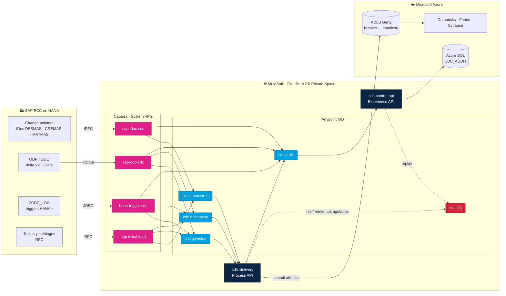

<sub>* `hana-trigger-cdc` solo aplica con licencia HANA *enterprise*. Con licencia *runtime*, ODP, IDoc y RFC cubren todo.</sub>

**Principio rector:** *nada se confirma antes de que el siguiente paso lo haya persistido.* Esto aplica al ACK de MQ, al delta token de ODP, a la marca `PROCESSED` en HANA y al tRFC del IDoc.

---

## 2. Capas API-led

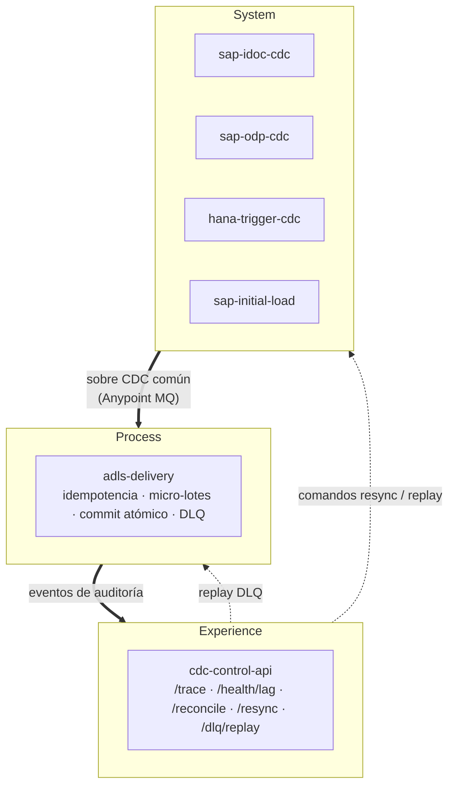

| Proyecto | Responsabilidad | Disparador |
|---|---|---|
| `sap-idoc-cdc` | Datos maestros por IDoc con tRFC | `sap:document-listener` |
| `sap-odp-cdc` | Deltas ODP; el token avanza solo después de publicar todo | `scheduler` cada 5 o 15 min |
| `hana-trigger-cdc` | Log de triggers, con una transacción por fila | `scheduler` cada 1 min |
| `sap-initial-load` | Carga histórica con Batch Job y recargas `/resync` | cron nocturno + MQ |
| `adls-delivery` | ACK manual, idempotencia, commit atómico, DLQ | `anypoint-mq:subscriber` |
| `cdc-control-api` | Operación, auditoría y conciliación diaria | `http:listener` + cron 03:00 |

---

## 3. El sobre CDC: un solo contrato

Todas las fuentes publican **el mismo sobre**. Por eso los mecanismos de captura son intercambiables: la entrega no sabe de dónde viene el dato. Esquema: [`mule/cdc-common/cdc-envelope.schema.json`](../mule/cdc-common/cdc-envelope.schema.json).

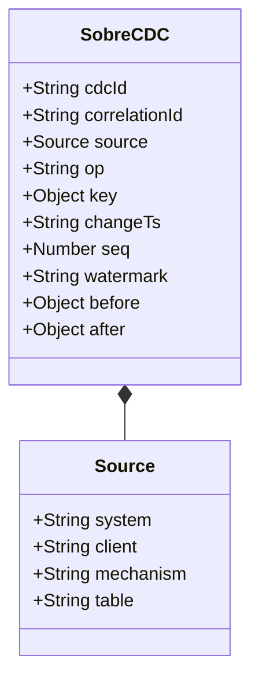

| Campo | Significado |
|---|---|
| `cdcId` | Hash determinista de la posición en SAP; llave de idempotencia |
| `correlationId` | Hilo de trazabilidad (DOCNUM, request ODQ, SEQ) |
| `op` | `I` alta · `U` cambio · `D` borrado · `R` foto (carga inicial) |
| `key` | Llave de negocio SAP para el MERGE |
| `seq` | Orden: en el MERGE gana el más alto |
| `watermark` | Posición en la fuente |
| `source.mechanism` | `IDOC` · `ODP` · `TRIGGER` · `SNAPSHOT` |

**El `cdcId` es determinista.** Se calcula como `SHA1(sistema, tabla, op, llave, semilla)`, donde la semilla es la posición en el origen:

| Mecanismo | Semilla |
|---|---|
| IDoc | `DOCNUM | segmento` |
| ODP | `delta link | página | fila` |
| Trigger | `ZCDC_LOG:SEQ` |
| Carga inicial | `partición | corrida | offset` |

Si SAP reenvía un IDoc o se repite un delta, el id es **el mismo** y el lago no se duplica.

---

## 4. Captura por dominio

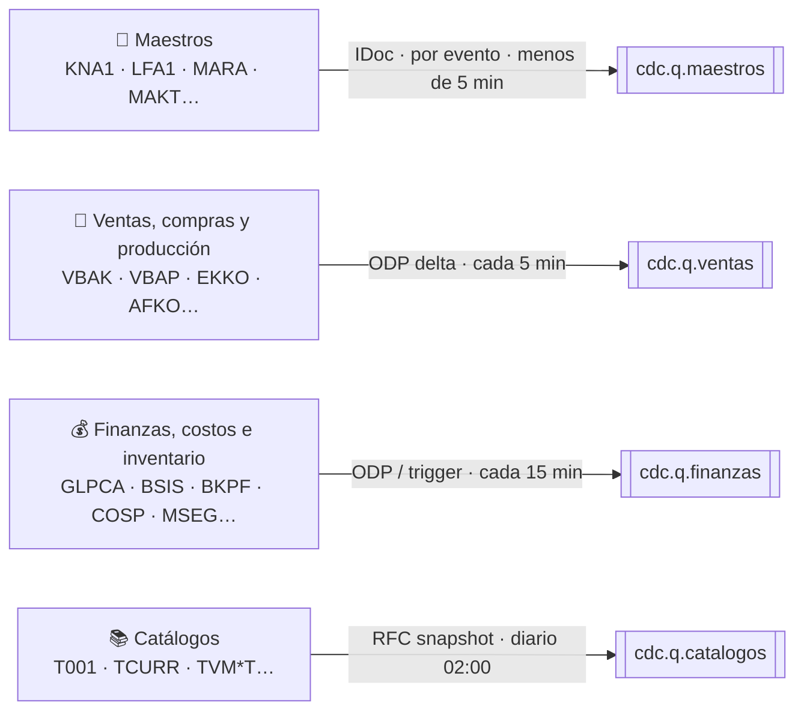

Volumetría real (2026): **~15,000 cambios por día hábil**, unos 25 por minuto en pico, y alrededor de 75,000 por día en el cierre de mes (×5). La operación diaria es ligera; el único desafío de volumen es la **carga inicial de ~75 GB**.

---

## 5. Entrega garantizada de punta a punta

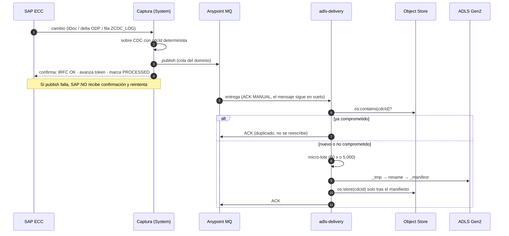

> **Garantía:** *al menos una vez* + **idempotencia por cdcId** = **efectivamente una vez**.
> Anypoint MQ no participa en transacciones XA; la transaccionalidad de punta a punta se logra con **ACK manual, commit en orden e idempotencia**.

---

## 6. Reintentos en 4 niveles

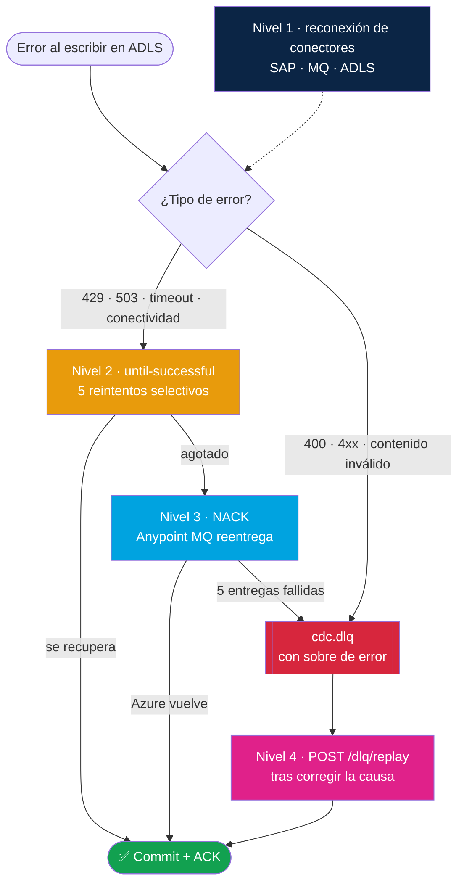

---

## 7. Commit atómico en ADLS Gen2

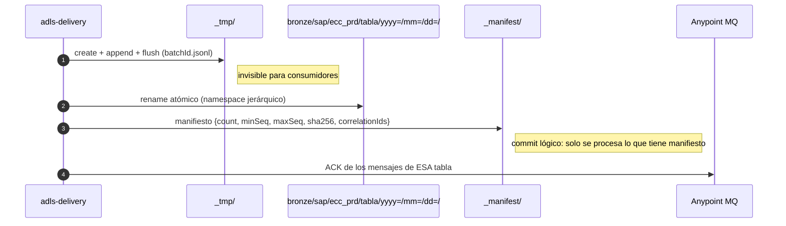

Cada tabla del micro-lote es una **unidad de commit independiente**: si una falla, las demás se confirman normalmente.

Ejemplo de consumo con Databricks:

```sql
MERGE INTO silver.vbap t USING bronze_vbap s
  ON t.VBELN = s.key.VBELN AND t.POSNR = s.key.POSNR
WHEN MATCHED AND s.seq > t.seq AND s.op = 'D' THEN DELETE
WHEN MATCHED AND s.seq > t.seq THEN UPDATE SET *
WHEN NOT MATCHED AND s.op <> 'D' THEN INSERT *
```

---

## 8. Ciclo de vida de un cambio

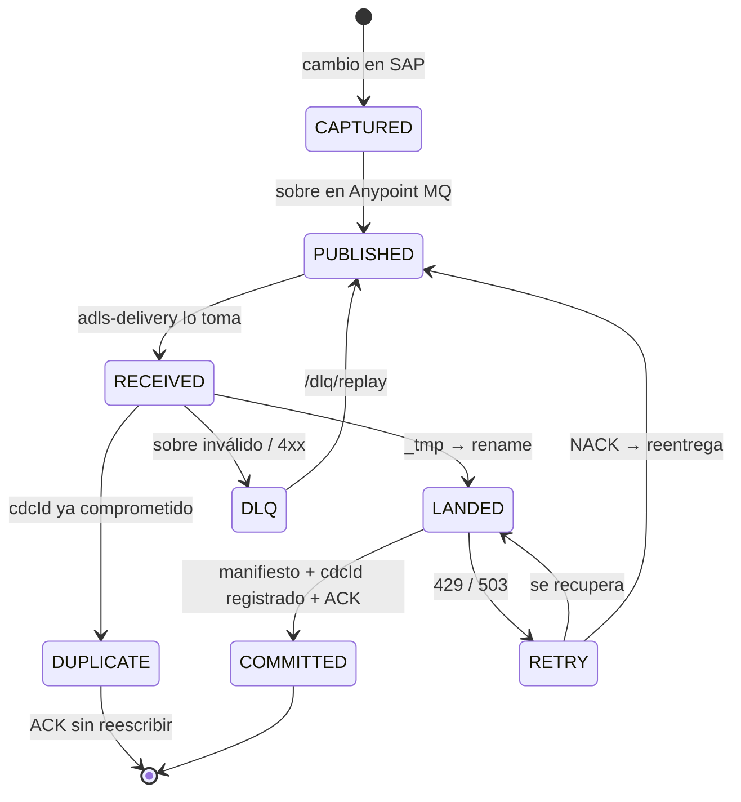

---

## 9. Trazabilidad y conciliación

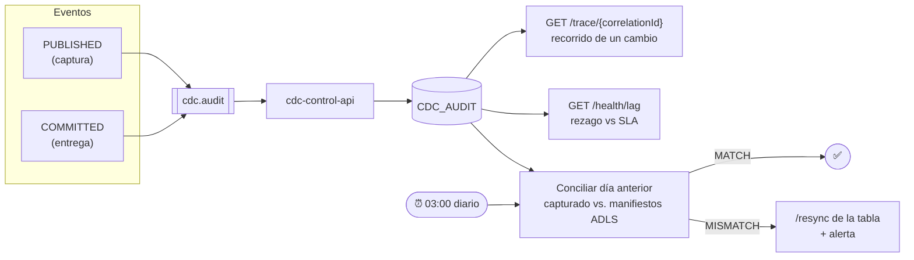

- **Un correlationId de punta a punta:** DOCNUM del IDoc, request de ODQ o SEQ del log.
- **Logs JSON por etapa:** `CAPTURED → PUBLISHED → RECEIVED → LANDED → COMMITTED` (o `DUPLICATE`, `RETRY`, `NACK`, `DLQ`).
- **Anypoint Monitoring:** alertas si la DLQ tiene más de 0 mensajes, si el rezago supera el SLA o si la conciliación da `MISMATCH`.

---

## 10. Carga inicial y paso a delta

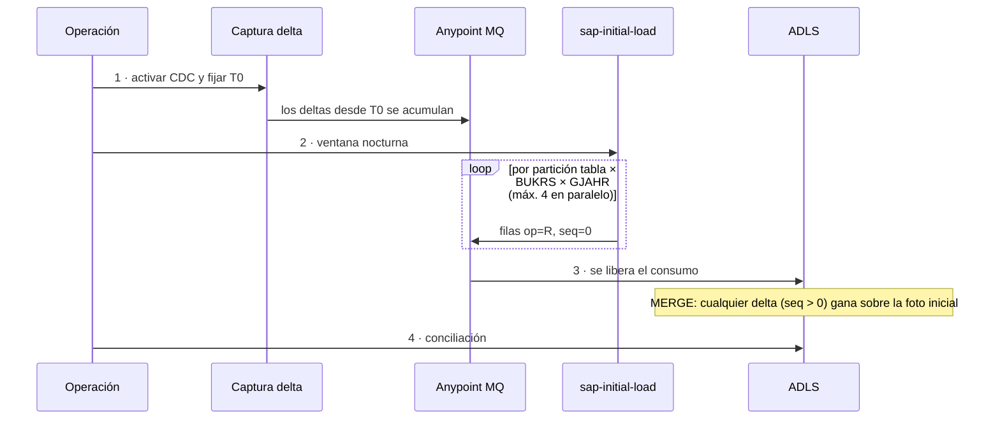

**Reanudable:** el estado de cada partición (`PENDING`, `RUNNING`, `DONE` o `FAILED`) vive en Object Store. Si la app se detiene, la siguiente ventana continúa donde se quedó.

---

## 11. Despliegue en CloudHub 2.0

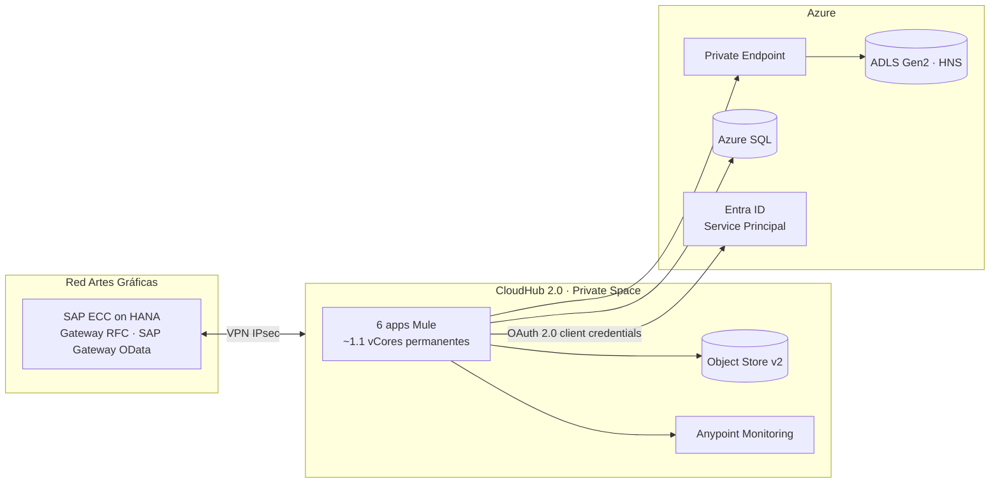

| Aplicación | Tamaño |
|---|---|
| `adls-delivery` | 0.2 vCore × 2 réplicas |
| `sap-idoc-cdc`, `sap-odp-cdc` | 0.2 vCore c/u |
| `hana-trigger-cdc`, `cdc-control-api` | 0.1 vCore c/u |
| `sap-initial-load` | 1 vCore **temporal** (se apaga al terminar) |

Secretos cifrados con Secure Properties (AES/CBC), TLS 1.2+, API Manager (Client ID Enforcement + OAuth) en la API de control y RBAC *Storage Blob Data Contributor* acotado al contenedor.
